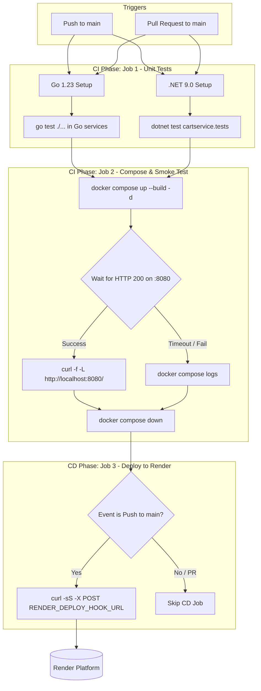

# CI/CD Pipeline with Compose Smoke Test & Render Deployment — Design Document

## 1. Current Context

- Online Boutique 為多語言微服務架構，目前由 `compose.yaml` 定義本機開發環境下的 11 個微服務與 Redis 快取。
- 專案根目錄目前未配置 `.github/` 資料夾或任何 CI/CD 工作流程（歷史 GitHub Actions 設定已於過去 commit `08d8a57f` 移除）。
- Codebase 目前擁有的自動化單元測試分佈於 C#（`cartservice`）與 Go（`checkoutservice`、`frontend`、`productcatalogservice`、`shippingservice`），各測試具備獨立記憶體隔離特性，無需外部 Redis 或資料庫連線即可執行。
- 本次需求旨在建立自動化 CI/CD 管線：
  1. **CI 階段**：當程式碼推播至 `main` 或針對 `main` 發起 PR 時，自動執行各語言單元測試，並以 Docker Compose 啟動完整微服務棧進行端對端冒煙測試（Smoke Test）。
  2. **CD 階段**：當 CI 階段成功通過且事件為推播至 `main` 分支時，自動觸發部署至 Render 平台。

---

## 2. Requirements

### Functional Requirements

- **觸發條件（Triggers）**：
  - 推播（`push`）至 `main` 分支時觸發管線。
  - 針對 `main` 分支發起拉取請求（`pull_request`）時觸發管線。
  - 當同一分支或 PR 頻繁推送新 commit 時，自動取消前次未完成的執行作業（`cancel-in-progress: true`）。
- **CI 階段 — 單元測試（Unit Tests）**：
  - 執行 Go 單元測試：涵蓋 `checkoutservice`、`frontend`、`productcatalogservice` 與 `shippingservice`，依據 `AGENTS.md:15` 執行 `go test ./...`。
  - 執行 C# / .NET 單元測試：依據 `AGENTS.md:16` 針對 `cartservice` 執行 `dotnet test src/cartservice/tests/cartservice.tests.csproj`。
- **CI 階段 — 端對端整合冒煙測試（E2E Smoke Test）**：
  - 單元測試通過後，在 Runner 虛擬機中依據 `compose.yaml:1-123` 執行 `docker compose up --build -d`。
  - 等待 `frontend`（Port 8080）與相依服務就緒。
  - 發送 HTTP GET 請求至 `http://localhost:8080/`，驗證回應狀態碼為 200 OK，驗證前端與後端 gRPC 服務鏈（商品目錄、匯率、購物車等）正常通訊。
  - 測試結束後無論成功或失敗均執行 `docker compose down`；若失敗則傾印容器日誌（`docker compose logs`）以供排查。
- **CD 階段 — Render 自動部署（Continuous Deployment）**：
  - **嚴格執行條件**：僅在 `push` 至 `main` 分支且所有 CI 測試（單元測試與 Smoke Test）全數通過後才執行；PR 事件嚴禁觸發 CD 部署。
  - 透過 Render Deploy Hook（Webhook URL）呼叫 Render API 觸發自動重新部署。
  - Deploy Hook URL 由 GitHub Repository Secrets（`RENDER_DEPLOY_HOOK_URL`）注入，保護機敏憑證。

### Non-Functional Requirements

- **命名規範**：工作流程檔案依使用者指定命名為 `.github/workflows/ci-cd.yaml`。
- **安全性**：Deploy Hook URL 不得明文寫入程式碼，必須透過 GitHub Secrets 安全管理。
- **除錯能力**：整合測試失敗時必須自動傾印所有容器日誌，確保 CI 介面具備可觀測性。
- **改動範圍限制**：僅新增 CI/CD 工作流程設定檔，不更動業務邏輯與既有微服務程式碼。

---

## 3. Design Decisions

### Selected Approach

- **選定方案：** Proposal 2 — 全自動整合驗證管線（All-in-One Compose Test & E2E Smoke Test Pipeline）結合 Render Deploy Hook CD。
- **核心設計：**
  1. 工作流程檔案定義於 `.github/workflows/ci-cd.yaml`。
  2. 採三階段相依架構：
     - **Job 1: `unit-tests`**：平行執行 Go（Go 1.23）與 .NET（.NET 9.0）單元測試，達成快速回饋。
     - **Job 2: `compose-smoke-test`**：依賴 Job 1，執行 `docker compose up --build -d`，對 `http://localhost:8080/` 進行 HTTP 探針檢測，驗證跨服務 gRPC 資料流。
     - **Job 3: `deploy-to-render`**：依賴 Job 2，限制條件為 `github.event_name == 'push' && github.ref == 'refs/heads/main'`，使用 `curl` 觸發 Render Deploy Hook。
- **選擇原因：**
  - Proposal 2 完整結合了專案核心架構 `compose.yaml` 與 `AGENTS.md` 的本地標準流程，能有效攔截環境變數缺失、連接埠衝突與 gRPC 服務通信問題。
  - 透過 Render 官方標準的 Deploy Hook 機制，無需在 Runner 安裝第三方 CLI 即可達成安全、即時的自動化部署。
- **Trade-offs：**
  - *優點*：具備完整的測試覆蓋（靜態單元邏輯 + 動態 Docker 容器執行期 + 生產環境部署），全流程自動化。
  - *代價與限制*：Compose 階段需完整構建 11 個映像檔，執行時間約 4-8 分鐘；部署至 Render 依賴使用者於 GitHub Repository Secrets 中正確設定 `RENDER_DEPLOY_HOOK_URL`。

---

## 4. Technical Design

### Core Components

1. **`.github/workflows/ci-cd.yaml` (new file)**：
   - 定義 GitHub Actions 工作流程的主設定檔。
   - 負責協調 `unit-tests`、`compose-smoke-test` 與 `deploy-to-render` 三個任務之生命週期與條件相依。

### Data Flow & Integration

#### 各階段具體通訊與協定：
- **單元測試通訊**：
  - `cartservice.tests` 透過 ASP.NET Core `TestServer` 建立記憶體 gRPC Channel，自動採用 `DistributedMemoryCache` (`src/cartservice/src/Startup.cs:51-56`)。
  - Go 各服務直接測試內部函式，不產生外部連線。
- **Smoke Test 通訊**：
  - Runner 透過 HTTP 呼叫 `http://localhost:8080/`（`compose.yaml:104-105`）。
  - `frontend` 接收請求後，透過 Docker 內部網路發起 gRPC 呼叫至 `productcatalogservice:3550`、`currencyservice:7000`、`cartservice:7070` 等。
- **Render CD 通訊**：
  - Runner 透過 HTTPS POST 請求傳送至 Render Deploy Hook URL（`https://api.render.com/deploy/srv-xxxxxx?key=yyyyyy`）。

### Files Changed

明確列出本次預計新增或修改的所有檔案：

- `.github/workflows/ci-cd.yaml` `(new file)` — 定義 CI/CD 完整工作流程（包含單元測試、Docker Compose 啟動與冒煙測試、Render 自動部署）。

---

## 5. Implementation Plan

### Step 1 — 建立 GitHub Actions 工作流程骨架與觸發條件
- **修改檔案**：`.github/workflows/ci-cd.yaml` `(new file)`
- **具體內容**：
  - 定義工作流程名稱 `CI/CD Pipeline`。
  - 配置觸發條件：`on.push.branches: [main]` 與 `on.pull_request.branches: [main]`。
  - 配置併發限制：`concurrency.group: ${{ github.workflow }}-${{ github.ref }}`，設定 `cancel-in-progress: true`。
- **完成條件**：YAML 語法檢驗正確，觸發與併發結構宣告完成。

### Step 2 — 實作 CI 單元測試作業 (`unit-tests`)
- **修改檔案**：`.github/workflows/ci-cd.yaml`
- **具體內容**：
  - 宣告 `unit-tests` Job，運行於 `ubuntu-latest`。
  - 設定 `actions/checkout@v4`。
  - 設定 `actions/setup-go@v5`（Go 1.23），以 shell 腳本依序對以下目錄執行 `go test ./...`：
    - `src/checkoutservice`
    - `src/frontend`
    - `src/productcatalogservice`
    - `src/shippingservice`
  - 設定 `actions/setup-dotnet@v4`（.NET 9.0），執行：
    - `dotnet test src/cartservice/tests/cartservice.tests.csproj`
- **完成條件**：單元測試能在 Runner 環境中自動執行並回傳各服務的測試結果。

### Step 3 — 實作 CI Docker Compose 整合與冒煙測試作業 (`compose-smoke-test`)
- **修改檔案**：`.github/workflows/ci-cd.yaml`
- **具體內容**：
  - 宣告 `compose-smoke-test` Job，設定 `needs: [unit-tests]`。
  - 檢出程式碼後執行 `docker compose up --build -d`。
  - 實作就緒輪詢腳本（每 3 秒檢查一次 `http://localhost:8080/`，最多重試 30 次 / 90 秒）。
  - 執行端對端 Smoke Test：使用 `curl -f -L http://localhost:8080/` 驗證首頁 HTTP 200。
  - 設定清理步驟（`if: always()`）：失敗時呼叫 `docker compose logs` 傾印日誌，最後呼叫 `docker compose down`。
- **完成條件**：容器建置、背景啟動、健康輪詢與清理流程完整建立。

### Step 4 — 實作 CD 階段 Render 自動部署作業 (`deploy-to-render`)
- **修改檔案**：`.github/workflows/ci-cd.yaml`
- **具體內容**：
  - 宣告 `deploy-to-render` Job，設定 `needs: [compose-smoke-test]`。
  - 設定執行條件 `if: github.event_name == 'push' && github.ref == 'refs/heads/main'`。
  - 注入環境變數 `RENDER_DEPLOY_HOOK_URL: ${{ secrets.RENDER_DEPLOY_HOOK_URL }}`。
  - 檢查 Secret 是否存在；若存在則以 `curl -sS -X POST "$RENDER_DEPLOY_HOOK_URL"` 呼叫 Webhook，並檢查 HTTP 回傳碼確認觸發成功。
- **完成條件**：推播至 `main` 時能自動觸發 Render Deploy Hook，且 PR 事件不會觸發此 Job。

---

## 6. Testing Strategy

### Unit Tests

- **驗證項目**：
  - Go 服務數值運算與驗證邏輯：`checkoutservice/money_test.go`、`frontend/validator_test.go`、`frontend/money_test.go`。
  - Go 服務 Mock 資料檢索：`productcatalogservice/product_catalog_test.go`。
  - Go 運費與免運規則：`shippingservice/shippingservice_test.go`。
  - C# 購物車快取操作：`cartservice/CartServiceTests.cs`。
- **預期結果**：所有既有測試在 GitHub Actions Runner 上 100% 通過（Exit code 0）。

### Integration / Functional Tests

- **Docker Compose 棧啟動與冒煙測試**：
  - 驗證 `compose.yaml:1-123` 宣告之 11 個微服務映像檔可順利多階段建置。
  - 驗證容器於背景啟動後，`frontend` 於指定超時內回應 HTTP 200。
  - 驗證容器關閉與日誌傾印指令正常執行。
- **Render CD 觸發驗證**：
  - 驗證 PR 事件觸發時，GitHub Actions UI 顯示 `deploy-to-render` 標記為 `Skipped`。
  - 驗證推送至 `main` 分支時，在 CI 通過後 `deploy-to-render` 正確發出 HTTP POST 請求至 Render。

---

## 7. References

- [research/ci-cd-test/research.md](file:///c:/Users/NCYU/Desktop/陳允瀚/軟工實務助教/115學年/教學計劃/ai-software-dev-demo/research/ci-cd-test/research.md)
- [research/ci-cd-test/proposals.md](file:///c:/Users/NCYU/Desktop/陳允瀚/軟工實務助教/115學年/教學計劃/ai-software-dev-demo/research/ci-cd-test/proposals.md) (Proposal 2)
- [AGENTS.md](file:///c:/Users/NCYU/Desktop/陳允瀚/軟工實務助教/115學年/教學計劃/ai-software-dev-demo/AGENTS.md#L7-L27)
- [compose.yaml](file:///c:/Users/NCYU/Desktop/陳允瀚/軟工實務助教/115學年/教學計劃/ai-software-dev-demo/compose.yaml#L1-L123)
- Render Deploy Hook Documentation: [https://docs.render.com/deploy-hooks](https://docs.render.com/deploy-hooks)
