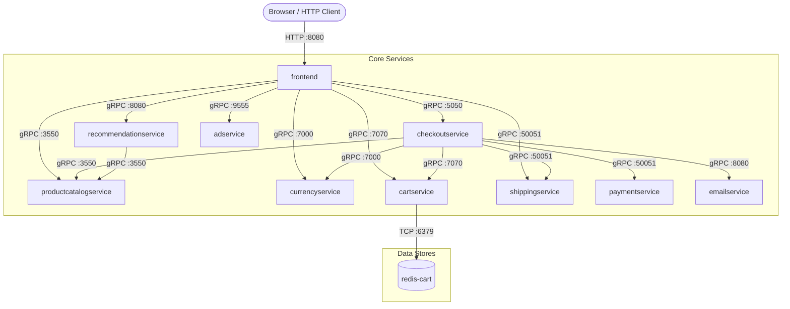

# Codebase 現況研究報告：CI/CD 與測試建置現況 (CI/CD & Testing Infrastructure Research)

## High-level Summary

本研究針對目前 codebase 關於 CI/CD 流程、自動化測試以及建置機制的現有實作進行全盤梳理。目前專案根目錄中不存在 `.github/` 資料夾或任何 CI/CD 工作流程定義檔（過去歷史 commit `08d8a57f` 曾移除包含 GKE 部署與單元測試之 GitHub Actions workflows）。現有自動化單元測試僅分佈於 C#（`cartservice`）與 Go（`checkoutservice`、`frontend`、`productcatalogservice`、`shippingservice`）微服務中，Java 服務（`adservice`）具備 Gradle 測試框架設定但無測試程式碼，Node.js 服務（`currencyservice`、`paymentservice`）在 `package.json` 中的測試腳本僅回傳錯誤退出，Python 服務則未配置測試檔。本地建置由 `compose.yaml` 定義 11 項服務並透過各目錄內的多階段 Dockerfile 執行容器化建置，測試的執行與相依性規範則記載於專案指引文件 `AGENTS.md`。

---

## Detailed Findings

### 1. CI/CD 工作流程現況與 Git 設定

- **目前 CI/CD 設定狀態**：
  - 專案根目錄目前沒有 `.github/`、`.gitlab-ci.yml` 或其他 CI/CD 設定檔案。
  - Git 分支目前本機存在 `main` 與 `ci-cd-test`，遠端為 `origin`（指向 `https://github.com/hanson92828/ai-software-dev-demo.git`），`ci-cd-test` 分支與 `main` 目前處於同一 commit（`6b08d638`）。
- **Git 歷史實作紀錄**：
  - 在 commit `08d8a57f`（*refactor: revise project setup to support Docker Compose-only deployment*）中，移除了歷史上的 `.github/workflows/` 設定檔：
    - 歷史檔案 `.github/workflows/ci-main.yaml` 過去定義在 `push` 到 `main` 與 `release/*` 時觸發，忽略 `**/README.md`、`kustomize/**`、`terraform/**`、`helm-chart/**`。其內包含 `code-tests`（執行 Go 與 .NET 測試）以及 `deployment-tests`（部署至 GKE 並執行 Locust smoke test）。
    - 歷史檔案 `.github/workflows/ci-pr.yaml` 過去定義在 `pull_request` 指向 `main` 時觸發，設定了 `concurrency`（`cancel-in-progress: true`），並包含 `code-tests` 與 `deployment-tests`。

### 2. 現有單元測試實作與分佈

#### A. C# / .NET 微服務 (`src/cartservice/`)
- **專案配置**：
  - 測試專案檔為 `src/cartservice/tests/cartservice.tests.csproj:1-21`，目標框架為 `net9.0`，引用 xUnit (`xunit: 2.9.3`)、`Microsoft.NET.Test.Sdk: 18.0.1` 與 `Microsoft.AspNetCore.TestHost: 9.0.11`，並依賴主專案 `src/cartservice/src/cartservice.csproj:1-21`。
- **測試實作**：
  - 測試實作於 `src/cartservice/tests/CartServiceTests.cs:27-160`，採用 ASP.NET Core `TestServer` 建立記憶體內 gRPC 測試伺服器與客戶端：
    - `GetItem_NoAddItemBefore_EmptyCartReturned` (`src/cartservice/tests/CartServiceTests.cs:41-68`)：測試尚未加入商品時，取得購物車回傳空結構。
    - `AddItem_ItemExists_Updated` (`src/cartservice/tests/CartServiceTests.cs:70-114`)：測試重複加入相同商品時數量累加，最後清空購物車。
    - `AddItem_New_Inserted` (`src/cartservice/tests/CartServiceTests.cs:116-158`)：測試加入新商品至購物車，驗證數量並清空。
- **測試執行相依性**：
  - 依據 `src/cartservice/src/Startup.cs:51-56`，當環境變數 `REDIS_ADDR` 未設定時，`cartservice` 會回退使用記憶體快取（`services.AddDistributedMemoryCache()`），因此測試案例可在無實體 Redis 伺服器下獨立執行。

#### B. Go 微服務 (`src/checkoutservice/`, `src/frontend/`, `src/productcatalogservice/`, `src/shippingservice/`)
各 Go 微服務皆使用 Go 1.23.0 規範（搭配 toolchain 1.24.x）：
- **`src/checkoutservice/`**：
  - 模組定義於 `src/checkoutservice/go.mod:1-10`。
  - 測試檔案為 `src/checkoutservice/money/money_test.go:1-245`，針對金額資料結構計算進行表格驅動測試（Table-driven tests）：
    - `TestIsValid` (`src/checkoutservice/money/money_test.go:28-50`)
    - `TestIsZero` (`src/checkoutservice/money/money_test.go:52-71`)
    - `TestIsPositive` (`src/checkoutservice/money/money_test.go:73-92`)
    - `TestIsNegative` (`src/checkoutservice/money/money_test.go:94-113`)
    - `TestSum` (`src/checkoutservice/money/money_test.go:115-171`)
    - `TestMultiplySlow` (`src/checkoutservice/money/money_test.go:173-225`)
    - `TestNegate` (`src/checkoutservice/money/money_test.go:227-245`)
- **`src/frontend/`**：
  - 模組定義於 `src/frontend/go.mod:1-10`。
  - 金額測試檔案為 `src/frontend/money/money_test.go:1-245`，包含與 `checkoutservice` 相同的 7 組金額函式測試。
  - 表單驗證測試檔案為 `src/frontend/validator/validator_test.go:1-185`，驗證訂單下單欄位檢驗邏輯：
    - `TestPlaceOrderPassesValidation` (`src/frontend/validator/validator_test.go:22-57`)：驗證合法下單內容。
    - `TestPlaceOrderFailsValidation` (`src/frontend/validator/validator_test.go:59-185`)：驗證錯誤 Email、地址長度超標、郵遞區號為 0、缺少縣市國家、卡號及過期年月等邊界情況。
- **`src/productcatalogservice/`**：
  - 模組定義於 `src/productcatalogservice/go.mod:1-11`。
  - 測試檔案為 `src/productcatalogservice/product_catalog_test.go:1-101`，使用 Mock 記憶體資料庫結構：
    - `TestMain` (`src/productcatalogservice/product_catalog_test.go:31-56`)：初始化 4 筆 mock 商品資料（`abc001` ~ `abc004`）。
    - `TestGetProductExists` (`src/productcatalogservice/product_catalog_test.go:58-68`)
    - `TestGetProductNotFound` (`src/productcatalogservice/product_catalog_test.go:70-77`)
    - `TestListProducts` (`src/productcatalogservice/product_catalog_test.go:79-89`)
    - `TestSearchProducts` (`src/productcatalogservice/product_catalog_test.go:91-100`)
- **`src/shippingservice/`**：
  - 模組定義於 `src/shippingservice/go.mod:1-11`。
  - 測試檔案為 `src/shippingservice/shippingservice_test.go:1-141`：
    - `TestGetQuote` (`src/shippingservice/shippingservice_test.go:26-107`)：測試免運費門檻計算邏輯，驗證未提供小計（回傳預設 $8.99）、金額小於 $200（回傳 $8.99）、金額達 $200 與超過 $200（回傳 $0.00）。
    - `TestShipOrder` (`src/shippingservice/shippingservice_test.go:110-141`)：驗證發貨 RPC 與回傳之追蹤碼長度。

#### C. Java 微服務 (`src/adservice/`)
- **建置配置**：
  - 構建配置於 `src/adservice/build.gradle:1-58`，設定 Java 19 相容性（`sourceCompatibility = JavaVersion.VERSION_19`），依賴 Gradle 8.14.3 wrapper（`src/adservice/gradle/wrapper/gradle-wrapper.properties:1-7`）。
- **測試現況**：
  - 該目錄下僅存在原始碼 `src/adservice/src/main/`，未建立 `src/adservice/src/test/` 目錄，目前無測試實作檔案。

#### D. Node.js 微服務 (`src/currencyservice/`, `src/paymentservice/`)
- `src/currencyservice/package.json:6-8` 與 `src/paymentservice/package.json:7-9` 的 `scripts` 欄位中均定義為：
  ```json
  "test": "echo \"Error: no test specified\" && exit 1"
  ```
- 兩者目前皆無配置測試框架或測試檔案。

#### E. Python 微服務 (`src/emailservice/`, `src/recommendationservice/`, `src/shoppingassistantservice/`, `src/loadgenerator/`)
- 該 4 項 Python 服務目錄中僅包含服務程式碼、`requirements.in` 與 `requirements.txt`，未存在 `*test*.py` 或 pytest 設定檔。

### 3. 本地建置與容器化實作 (`compose.yaml` 與 Dockerfiles)

- **Compose 服務定義**：
  - `compose.yaml:1-123` 定義了 11 個執行服務：
    - `redis-cart` (`compose.yaml:10-19`)：使用映像檔 `redis:7-alpine`。
    - `productcatalogservice` (`compose.yaml:20-26`)：建置 context `./src/productcatalogservice`。
    - `currencyservice` (`compose.yaml:27-33`)：建置 context `./src/currencyservice`。
    - `cartservice` (`compose.yaml:34-44`)：建置 context `./src/cartservice/src`，指定 `Dockerfile`。
    - `shippingservice` (`compose.yaml:45-51`)：建置 context `./src/shippingservice`。
    - `paymentservice` (`compose.yaml:52-58`)：建置 context `./src/paymentservice`。
    - `emailservice` (`compose.yaml:59-65`)：建置 context `./src/emailservice`。
    - `recommendationservice` (`compose.yaml:66-75`)：建置 context `./src/recommendationservice`。
    - `adservice` (`compose.yaml:76-81`)：建置 context `./src/adservice`。
    - `checkoutservice` (`compose.yaml:82-100`)：建置 context `./src/checkoutservice`。
    - `frontend` (`compose.yaml:101-123`)：建置 context `./src/frontend`，對外公開連接埠 `127.0.0.1:8080:8080`。
- **Dockerfile 實作位置**：
  - `src/adservice/Dockerfile:1-41`
  - `src/cartservice/src/Dockerfile:1-57`（另含 `Dockerfile.debug:1-33`）
  - `src/checkoutservice/Dockerfile:1-41`
  - `src/currencyservice/Dockerfile:1-42`
  - `src/emailservice/Dockerfile:1-56`
  - `src/frontend/Dockerfile:1-41`
  - `src/loadgenerator/Dockerfile:1-43`
  - `src/paymentservice/Dockerfile:1-42`
  - `src/productcatalogservice/Dockerfile:1-42`
  - `src/recommendationservice/Dockerfile:1-58`
  - `src/shippingservice/Dockerfile:1-41`
  - `src/shoppingassistantservice/Dockerfile:1-44`

### 4. 專案指引文件規範 (`AGENTS.md` & `README.md`)

- `AGENTS.md:7-20` 明確定義測試與建置操作指令：
  - `docker compose up --build -d`：建置並啟動本機應用程式。
  - `docker compose build frontend`：單獨建置指定服務映像檔。
  - `go test ./...`：於單一 Go 服務目錄內執行測試（例：`src/frontend/`）。
  - `dotnet test src/cartservice/tests/cartservice.tests.csproj`：執行 cartservice 的 xUnit 測試。
  - `cd src/adservice && ./gradlew test`：執行 adservice 的 Java/Gradle 測試。
  - `AGENTS.md:19` 載明：*Node.js services currently have no implemented test script; do not treat npm test as a passing check.*
- `README.md:35-74` 提供本機以 Docker Compose 啟動與重建單一服務的說明。

---

## Component 之間的關聯與資料流（Data Flow）

### 1. 執行時期架構與依賴關係

各服務之間透過 gRPC 協定通訊，依據 `compose.yaml:82-123` 的相依宣告與埠號指引，資料流如下：



### 2. 測試層級之依賴與隔離性

目前 codebase 中的測試均為**單元測試**（Unit Tests），各測試元件與執行時依賴關係如下：

| 元件名稱 | 測試檔案位置 | 外部相依狀態 | 隔離方式 |
| :--- | :--- | :--- | :--- |
| **cartservice** | `src/cartservice/tests/CartServiceTests.cs:27-160` | 無 Redis 依賴 | 透過 ASP.NET Core `TestServer` 建立記憶體 gRPC 通道，且未指定 `REDIS_ADDR` 時自動採用 `DistributedMemoryCache` (`src/cartservice/src/Startup.cs:51-56`)。 |
| **checkoutservice** | `src/checkoutservice/money/money_test.go:1-245` | 無外部依賴 | 純粹數學與 Money protobuf 結構之數值運算單元測試。 |
| **frontend** | `src/frontend/money/money_test.go:1-245`<br>`src/frontend/validator/validator_test.go:1-185` | 無外部依賴 | 純粹資料結構驗證（Validator）與數值轉換測試。 |
| **productcatalogservice** | `src/productcatalogservice/product_catalog_test.go:1-101` | 無外部依賴 | 透過 `TestMain` 注入記憶體 Mock 清單（`src/productcatalogservice/product_catalog_test.go:31-56`），不連線至外部資料庫。 |
| **shippingservice** | `src/shippingservice/shippingservice_test.go:1-141` | 無外部依賴 | 實例化記憶體中的 `server{}` 結構進行直接呼叫測試，不經由網路層。 |

---

## 程式碼參照清單 (Code References)

* **Git / CI 設定歷史**：
  * Commit `08d8a57f`: `.github/workflows/ci-main.yaml` (歷史已刪除)
  * Commit `08d8a57f`: `.github/workflows/ci-pr.yaml` (歷史已刪除)
* **C# / .NET 測試**：
  * `src/cartservice/tests/cartservice.tests.csproj:1-21`
  * `src/cartservice/tests/CartServiceTests.cs:27-160`
  * `src/cartservice/src/Startup.cs:51-56`
* **Go 測試與模組定義**：
  * `src/checkoutservice/go.mod:1-10`
  * `src/checkoutservice/money/money_test.go:28-245`
  * `src/frontend/go.mod:1-10`
  * `src/frontend/money/money_test.go:28-245`
  * `src/frontend/validator/validator_test.go:22-185`
  * `src/productcatalogservice/go.mod:1-11`
  * `src/productcatalogservice/product_catalog_test.go:31-101`
  * `src/shippingservice/go.mod:1-11`
  * `src/shippingservice/shippingservice_test.go:26-141`
* **Java 建置**：
  * `src/adservice/build.gradle:1-58`
  * `src/adservice/gradle/wrapper/gradle-wrapper.properties:1-7`
* **Node.js 套件與腳本**：
  * `src/currencyservice/package.json:6-8`
  * `src/paymentservice/package.json:7-9`
* **容器建置與 Compose 定義**：
  * `compose.yaml:1-123`
  * `src/adservice/Dockerfile:1-41`
  * `src/cartservice/src/Dockerfile:1-57`
  * `src/checkoutservice/Dockerfile:1-41`
  * `src/currencyservice/Dockerfile:1-42`
  * `src/emailservice/Dockerfile:1-56`
  * `src/frontend/Dockerfile:1-41`
  * `src/loadgenerator/Dockerfile:1-43`
  * `src/paymentservice/Dockerfile:1-42`
  * `src/productcatalogservice/Dockerfile:1-42`
  * `src/recommendationservice/Dockerfile:1-58`
  * `src/shippingservice/Dockerfile:1-41`
  * `src/shoppingassistantservice/Dockerfile:1-44`
* **專案規範文件**：
  * `AGENTS.md:7-27`
  * `README.md:35-74`
